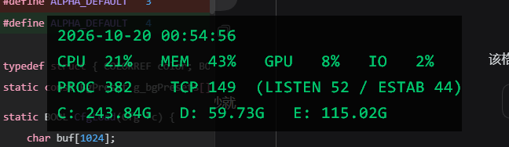

# hudcinfo · improved preview

> **非官方改进预览版 / Unofficial improved preview**
> 基于网友 **Ra1nyxin** 的原作 `hudcinfo` 修改而来。
> 原作者尚未公开上游仓库 —— **本仓库不是官方版本**，也不代表原作者维护，原代码版权归 Ra1nyxin 所有。

桌面上一行安静的系统状态 · 半透明 · 鼠标穿透 · 纯 C 单文件 · 无第三方依赖



---

## 这是什么

- **原作**：Ra1nyxin 的 `hudcinfo` —— 一个 Win32 半透明系统状态悬浮条（CPU / MEM / GPU / IO / PROC / TCP / 磁盘）。
- **本仓库**：在其基础上做的改进与预览打包，主打「任意分辨率、任意 DPI 都能用，而且可以随手调教」。
- 上游状态见 [UPSTREAM.md](UPSTREAM.md)，变更记录见 [CHANGELOG.md](CHANGELOG.md)，版权与署名见 [NOTICE.md](NOTICE.md)。

## 相对原作的改动

| 项 | 原作 | 本版 |
|:---|:---|:---|
| 位置 | 写死 1920×1080 的坐标 | 首次居中 · 记住位置 · 分辨率变化自动回中（运行中也生效） |
| DPI | 系统级，改缩放后坐标准位 | 逐显示器 DPI 感知 V2，任意缩放鼠标判定都对得上 |
| 交互 | 无 | `Ctrl+Alt` + 拖动 / 滚轮 / 方向键 / G W Y R B P |
| 透明度 | 整窗一个 alpha，调底就调字 | 逐像素 alpha：字固定 200，只有底色可调 |
| 底色 | 只有黑 | 8 档：透明 黑 白 红 黄 绿 蓝 紫 |
| 置顶 | 会被后开的窗口盖住 | 每次送显后重新置顶 |

---

## 快速开始

双击 `hudcinfo.exe` 即可。第一次运行出现在屏幕正中，之后记住你的位置和外观。

> 平时它完全穿透：点不到它、挡不住任何操作。

---

## 操作

**按住 `Ctrl + Alt`，鼠标停在面板上**，然后：

| 操作 | 效果 |
|:---|:---|
| 左键拖动 | 挪位置 |
| 滚轮 `↑` `↓` | 尺寸 5 档（等比，字号同步） |
| `←` `→` | 底色 8 档：透明 黑 白 红 黄 绿 蓝 紫 |
| `↑` `↓` | 底色深浅 7 档：30 · 80 · 120 · **200** · 235 · 255（30≈几乎全透明） |
| `G` `W` `Y` `R` `B` `P` | 字色：绿 白 黄 红 蓝 紫 |

字的不透明度固定在 **200**（原作值），调底色深浅不会把字一起调淡。

---

## 档位

| 项 | 可选值 |
|:---|:---|
| 尺寸（100% 缩放，DPI 自动放大） | 13 / 15 / **17** / 20 / 24 px 字号，面板宽高成比例 |
| 底色不透明度 | 30 · 80 · 120 · **200** · 235 · 255 |
| 底色 | 透明 · **黑** · 白 · 红 · 黄 · 绿 · 蓝 · 紫 |
| 字色 | **绿** · 白 · 黄 · 红 · 蓝 · 紫 |

想要纯色或改档位，直接改 `main.c` 里的 `g_presets[]` / `g_alphaPresets[]` / `g_bgPresets[]` / `g_fgPresets[]`。

---

## 配置文件

与 exe 同目录的 `hudcinfo.ini`，自动生成：

```ini
[state]
ver=3
x=963
y=631
level=2        ; 尺寸档
alpha=4        ; 底色深浅档
bg=1           ; 底色档
fg=0           ; 字色档
screenw=2560   ; 上次运行的分辨率
screenh=1440
```

- 分辨率没变 → 回到上次的位置和外观
- 分辨率变了（含**运行中**改分辨率 / 改缩放）→ 自动回到屏幕正中
- 想恢复出厂 → 删掉这个文件再启动

---

## 编译

需要 MinGW-w64（gcc）：

```bash
gcc -O2 -mwindows main.c -o hudcinfo.exe \
    -lpdh -lpsapi -liphlpapi -lws2_32 -lgdi32 -luser32 -static -s
```

---

## 备注

- 用 `WH_MOUSE_LL` / `WH_KEYBOARD_LL` 全局钩子接管操作，只在 `Ctrl+Alt` + 鼠标在面板上时生效，其余全部放行；个别杀软对钩子敏感，误报就加白名单。
- 进程是**逐显示器 DPI 感知 V2**，坐标全程物理像素：改分辨率 / 改缩放后，面板尺寸、位置和鼠标判定依旧对齐。
- 部分显卡驱动把 `Ctrl+Alt+方向键` 绑成了旋转屏幕，会和 `←` `→` 换底色冲突，到驱动面板里关掉即可。
- 若想让文字完全实心，把 `#define TEXT_ALPHA 200` 改成 `255`。

---

## 署名与授权

- **原作 / 原始代码**：Ra1nyxin（上游仓库尚未公开）
- **本版改进与打包**：SinArc163（[@SinArc163](https://github.com/SinArc163)）
- 本仓库是**非官方改进预览版**，不是官方版本，也不代表原作者立场。
- 原作者尚未提供公开许可证；若原作者认为公开分发不妥，issue 联系后会立即转私有或删除。
- 详见 [NOTICE.md](NOTICE.md)。

> 命名遵循「原名可追溯 + 明确 preview/improved + 标明非官方 + 保留原作者署名」的原则：
> 仓库名 `<原名>-improved-preview`、分支 `preview`、标签 `v0.1.0-preview.1`，
> 不使用 official / final / stable 这类容易误导的措辞。
